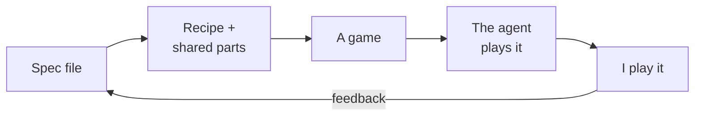
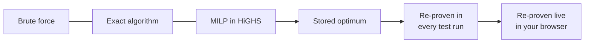
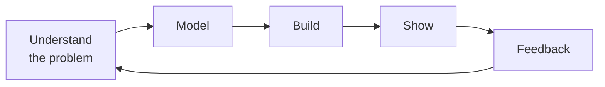

# Can you beat the Algorithm?

## Using GenAI to create an OR Games Factory

Jens-Peter Joost · JPJ Solutions

<div class="abs-bl m-6 text-sm opacity-70">
  GOR AG Praxis der Mathematischen Optimierung · Munich · 26 November 2026
</div>

<!--
DRAFT. Everything marked TODO needs Peter's numbers or pictures.

Timing plan (35 min + 10 min discussion):
 0– 4  Play
 4– 8  Why games
 8–16  The factory
16–25  What worked, what did not
25–33  So what? (transfer)
33–35  Close

Do NOT open with AI. Open with the game.
Games run from the laptop (npm run build:pages in the games repo, then serve _site) — no venue wifi needed.
-->

---
layout: image-right
image: /assets/games/cart-and-run.jpg
backgroundSize: contain
---

# Let's play

Cart & Run, room 1

<v-clicks>

- Loot on the floor. A mine cart in the middle.
- Your arms carry **4** at a time.
- The minotaur takes a step **only when you do**.
- There is more gold than you can carry out.

</v-clicks>

<v-click>

**You tell me what to grab.**

</v-click>

<!--
LIVE DEMO. Switch to the browser: Cart & Run, room 1, already past the title and the how-to.
Let the room call the moves. Nothing is timed, so they can argue.
Then press on to the reveal: the solver's trips in the same room. Proven best for room 1: 57 gold.

If the demo fails: the four recorded clips are on the backup slides at the very end.
-->

---

# What you just solved

A **prize-collecting, capacitated vehicle routing problem**

| In the dungeon              | In a model                | At work                              |
| --------------------------- | ------------------------- | ------------------------------------ |
| Loot on the floor           | Customers with a prize    | Orders worth serving, or not         |
| What your arms can carry    | Vehicle capacity          | Payload of a van                     |
| The cart                    | Depot                     | Warehouse                            |
| Steps before the minotaur   | Route length budget       | Shift length, driving time           |
| The loot you leave behind   | Customers not visited     | Orders you decline or postpone       |

<v-click>

Room 1: the proven best is **57 gold**. In the five rooms, the obvious plays end **8–21 % short**.

</v-click>

<!--
"Obvious plays" = two greedy rules: best value per weight first, and best value first.
The best of the two falls 8–21 % short of the proven optimum across the five rooms (57 / 62 / 84 / 105 / 145).
Every optimum needs several trips and leaves loot on the floor.
-->

---
layout: image-right
image: /assets/peter.png
---

# Hello there!

I'm Peter.

```
2018             M.Sc. Mathematics
2019 - 2025      Data Scientist at DHL
Since 04/2025    OR Freelancer, JPJ Solutions
```

<v-click>

People ask me what Operations Research is.

**I let them play it.**

</v-click>

---
layout: statement
---

# An OR problem is a game

A clearly defined setting. Limited resources. The highest possible score.

---

# Seven games, seven problems

| Game                  | The problem inside                         | Where it costs real money        |
| --------------------- | ------------------------------------------ | -------------------------------- |
| Dungeon Hoard         | 2D knapsack / packing                      | Truck and container loading      |
| Norias of the Dunes   | Maximal covering location                  | Where to put sites and stations  |
| The Spice Route       | Travelling salesman                        | Routing and sequencing           |
| The Quest Board       | Assignment                                 | Who does which job               |
| Plunder Deck          | 3D loading with stacking rules             | Pallets and containers           |
| Cart & Run            | Prize-collecting capacitated routing       | Delivery with capacity and time  |
| The Labyrinth Keeper  | Shortest-path interdiction                 | Network resilience               |

<!--
Each game: short intro, play, score, then a REAL algorithm solves the same level live, side by side with your attempt.
Then: the OR problem in plain words, where it shows up in industry, a link to a use-case page.
-->

---
layout: image
image: /assets/games/hub.jpg
backgroundSize: contain
---

<!--
The hub: a map you walk across. Seven places, one game each.
Optional: show it live for 20 seconds — walk to a gate, press Play.
-->

---

# Why I built this

<v-clicks>

- I am a one-person OR consultancy. Most prospects do not know they have an OR problem.
- A game gets me the sentence I am after: *"Oh, we have a problem like that."*
- Every game ends the same way: **your plan next to a proven optimum**, and where the same structure shows up at work.
- Side effect: it works for students too.

</v-clicks>

<!--
Keep the teaching point to this one line. The room is practitioners.
Honest framing: this started as marketing.
-->

---
layout: quote
---

# "Optimal" only when the solver proves it.

The one rule every game has to follow

<!--
A real solver runs in every game, live, in the player's browser:
- HiGHS compiled to WebAssembly for the MILPs (packing, covering, 3D loading, routing, interdiction)
- Held–Karp dynamic programming for the TSP (up to 18 ports)
- The Hungarian method for assignment
Never a stored number presented as a live solve. If a time limit hits, the game says "best found".
-->

---
layout: section
---

# The factory

How seven games got built

---

# Timeline

<v-clicks>

- **May 2026** · first game. One HTML file becomes a tested project with a live solver.
- **June 2026** · seven games, one shared solver package.
- **10–12 November 2026** · everything rebuilt in 3D, plus a map to walk across. **40 commits in three days.**

</v-clicks>

<v-click>

| Commits | Lines of code | Test files | Games |
| ------- | ------------- | ---------- | ----- |
| ~130    | ~40,000       | 45         | 7 + a hub |

</v-click>

<!--
Tools: Claude Code throughout. The 2D versions mostly with Claude Opus 4.8; the 3D overhaul with Claude Fable 5.2.
Say clearly: this is an anecdote, not a benchmark. One person, one project.

TODO (Peter): hours of your own time and what it cost, for the 2D phase and for the overhaul.
-->

---
layout: two-cols
layoutClass: gap-8
---

# Before

May: one HTML file


::right::

# After

November: same levels, same solver, same optima


<!--
The puzzle did not change: same five stages, same loot, same optima (120 / 340 / 485 / 585 / 825).
Only the look and the handling changed. The tests that re-prove the optima kept that honest.
-->

---

# What "factory" means



<v-clicks>

- **A spec the agent reads first**: what the project is for, what is done, what "done" means.
- **A recipe**: OR problem, setting, rules as plain logic, solver, reveal, text, checks.
- **Shared parts**: one solver package (packing, covering, TSP, assignment, flow, routing, interdiction).
- **An acceptance test the agent can run by itself.**

</v-clicks>

<!--
The spec file is CLAUDE.md in the repo. It is long, and it is the most valuable file in the project.
A new game is one or two sessions because the first game was turned into a template.
-->

---
layout: two-cols
layoutClass: gap-8
---

# What I did

<v-clicks>

- Chose the problems and the settings
- Said what good looks like, and what does not
- Played, listened, complained
- Decided

</v-clicks>

::right::

# What the agent did

<v-clicks>

- Wrote the code
- Built and solved the models
- Designed the levels
- Wrote the tests
- Played its own games
- Kept the documentation

</v-clicks>

<!--
I did not write the code. I did read the plans and the reports, and I played every build.
-->

---

# Levels designed with the solver in the loop

Every level is a trap for the obvious play. **Proven, not hoped.**

<v-clicks>

1. A seeded search proposes a level.
2. The real solver proves its optimum.
3. A greedy player is simulated on the same level.
4. The level is kept only if greedy **provably** falls short.

</v-clicks>

<v-click>

| Game                 | The obvious play                 | Result                         |
| -------------------- | -------------------------------- | ------------------------------ |
| The Quest Board      | Best hero-job pair first         | 15–33 gold short on days 2–5   |
| The Labyrinth Keeper | Best single wall, then the next  | Path of 6 where 14 is possible |
| Cart & Run           | Best value per weight first      | 8–21 % short                   |

</v-click>

<!--
This is the part OR people like: the level design is itself an optimisation loop.
"Two stars" in each game is exactly the greedy result; three stars needs the optimum.
-->

---

# Chain of trust



<v-clicks>

- No optimum is typed in by hand and trusted.
- Two independent methods must agree before a number is stored.
- The player's machine proves it once more.

</v-clicks>

<!--
Example: Quest Board optima are checked three ways on every test run — Hungarian, all n! rosters, and HiGHS.
This is what lets me say "proven" on stage without flinching.
-->

---
layout: image-right
image: /assets/games/plunder-deck.jpg
backgroundSize: contain
---

# The agent plays its own games

<v-clicks>

- A headless browser, real clicks and drags
- Desktop and phone size
- An optimal play-through of every level
- Five live solver proofs per game
- No errors in the console
- Then, and only then, it says "done"

</v-clicks>

<!--
The "how to play" clips in the games are recorded by the same robot: it plays the first level with a visible finger.
-->

---
layout: section
---

# What worked, and what did not

---

# What worked

Everything that can be **measured**

<v-clicks>

- Models and solvers, checked against brute force
- Level design with proven properties
- Refactoring a single file into a tested project
- Finding its own bugs by playing: a camera that ignored the HUD, loot sliding under a button
- Performance, once it had numbers: one extra inequality took a proof from seconds to 30 ms

</v-clicks>

<!--
The inequality story comes back in the last part.
-->

---

# What did not work: taste

<v-clicks>

- The first 3D look was built entirely in code: blobs with googly eyes.
- My verdict: **goofy and unprofessional.**
- The fix was not a better prompt. It was a decision: use open, hand-made model packs.

</v-clicks>

<!--
TODO (Peter): a screenshot of the rejected first look, if you still have one. It would carry this slide.
The models are the CC0 KayKit packs by Kay Lousberg.
-->

---

# What did not work: ears and real hardware

<v-clicks>

- It wrote music it **cannot hear**. The first soundtrack was an 18-second loop. Very annoying.
- On my laptop: frame drops, blank frames, sound piling up until there was none.
- On the map, a ship sailed **straight through the islands**.
- None of it showed in the tests. The tests have no ears and no laptop.

</v-clicks>

<!--
Once I reported them, the causes were found by measurement and fixed: quality settings that swung back and forth,
finished notes that stayed wired into the audio graph, a route drawn as a curve through the ports.
The point: it could fix them. It could not notice them.
-->

---

# What did not work: knowing what I meant

<v-clicks>

- I asked for **options** on loading time. I had to add: *please do not start building.*
- A LinkedIn button quietly became "Back to the map".
- "Done" sometimes meant "the check passed", and the check was the wrong one.

</v-clicks>

<!--
None of these are dramatic. All of them are the same thing: intent is not in the code.
Optional anecdote: the second game was filed under "network flow" and turned out to be maximal covering — labels are cheap.
-->

---

# The pattern

| It could measure it                     | It needed a human                |
| --------------------------------------- | -------------------------------- |
| Is the optimum proven?                  | Does it look good?               |
| Does greedy fall short?                 | Does it sound good?              |
| Does the build pass on desktop + phone? | Does it run on *my* laptop?      |
| Is it fast?                             | Is this what I meant?            |

<v-click>

**That line is the line between building and feedback.**

</v-click>

---
layout: section
---

# So what?

From games to OR projects

---

# Solving is getting cheap

<v-clicks>

- **203** open MIPLIB instances handed to an AI model
- **72** solutions better than the best known
- **45** proved optimal
- One of them: timing 42 trains to cut peak power use, 2.6 % better in under two hours

</v-clicks>

<v-click>

Reported by the vendor (Anthropic, 9 November 2026). Solutions were submitted to MIPLIB.

**Solving is not modelling.** On real-size models, AI modelling from a text description still drops sharply (MIPLIB-NL, 2026).

</v-click>

<!--
TODO (Peter): check miplib.zib.de the week before and quote what is listed there. People who know MIPLIB closely are in the room.
Sources: Anthropic's launch thread of 9 Nov 2026; MIPLIB-NL: arXiv 2602.10450.
Use this as "a well-posed problem is getting cheap to solve" — NOT as "modelling is solved".
-->

---

# The OR project loop



<v-clicks>

- **Model and build**: weeks became days, days became hours.
- **Show and feedback**: still at the speed of people.
- The bottleneck moved. It now sits where the planner and the OR person have to **mean the same thing**.

</v-clicks>

<!--
Forward reference: Justus Wolff (bools) makes a neighbouring point from the model side at 15:15.
Mine is from the human side: the shared picture of the problem.
-->

---
layout: two-cols
layoutClass: gap-8
---

# The game

Where do the water wheels go?


::right::

# The project

Where do the warehouses go?


<!--
Same question. One counts palms, the other counts euros.
The tool on the right is a neutral copy, on made-up data, of something I built for a client.
It is live at jpjsolutions.com/use-cases/facility-location — switch to it now.
-->

---
layout: image-right
image: /assets/facility-opening.jpg
backgroundSize: contain
---

# Planners play against the optimum

<v-clicks>

- Open and close sites. Move single customers.
- Change the cost assumptions.
- Always next to it: **the proven optimum**, in euros a year.
- The opening network here: **25.6 % above** the optimum.

</v-clicks>

<!--
LIVE: jpjsolutions.com/use-cases/facility-location (works offline from the laptop build too).
Fictional distributor, 12 candidate sites, 36 customer cities, invented demand and costs.
HiGHS proves the optimum in the browser, typically in well under a second.

TODO (Peter): how long the original client tool took to build, and how the planners used it.
-->

---
layout: image-right
image: /assets/facility-rules.jpg
backgroundSize: contain
---

# Then they bend it

<v-clicks>

- Start **from** the optimum.
- Change what real life will not allow.
- Every change becomes a **rule**.
- Re-optimise around the rules: each one gets a **price**.

</v-clicks>

<v-click>

| Rule                             | Price a year |
| -------------------------------- | ------------ |
| München stays open               | +€441k       |
| Kassel is served from Berlin     | +€23k        |

</v-click>

<!--
This is the heart of the talk. An edit is knowledge the model did not have.
Forward reference: Eunji Lee (Sixt) at 13:30 — expert adjustments that never feed back into the model.

The "re-optimise around my rules" part is an extension I added for this version.

TODO (Peter): one or two real edits your client's planners made, and why.
-->

---

# One inequality

A modelling aside

The first version of that model needed **2 to 8 seconds** to prove the optimum.

$$
\sum_{i} y_i \;\ge\; \left\lceil \frac{\sum_j d_j}{C} \right\rceil
$$

At least that many sites must be open to carry all the demand.

<v-click>

With it: **about 30 ms**. Same optimum.

</v-click>

<!--
Implied for integer solutions, but not for the LP relaxation — the classic kind of cut.
The agent found it by measuring 400 parameter settings and noticing the slow ones were the tight-capacity ones.
That is "what can be measured" again.

The neutral copy was built for this talk: from approved plan to merged page in under an hour of agent time.
-->

---
layout: statement
---

# In a game, the algorithm always wins.

# In a project, you want the planner to win.

Every time they do, your model is missing a constraint.

<!--
Pause here.
"Can you beat the algorithm?" — in a real project that is the question you want answered with yes, early.
-->

---

# Three things to take home

<v-clicks>

1. **Building got cheap.** Spend the time you save on feedback.
2. **Let the agent verify everything that can be measured.** You judge the rest.
3. **Make the problem playable, in week one.** It is the fastest way to find out what your model does not know.

</v-clicks>

---
layout: two-cols
layoutClass: gap-8
---

# Your turn

A question for the room

### Where did your planners last beat your model?

<br>

Play the games:

**games.jpjsolutions.com**

The facility tool:

**jpjsolutions.com/use-cases/facility-location**

::right::


<!--
10 minutes of discussion. The question on the slide is the opener.

Questions to expect:
- What did it cost, in hours and money?  (TODO: numbers)
- Did you read the code?
- Would you trust it on a client model?
- What about client data and confidentiality?
- Did the games bring any business?
- Does any of this hold beyond toy instances?
-->

---
layout: end
---

# Thank you

jpjsolutions.com

---
layout: two-cols
layoutClass: gap-8
zoom: 0.62
---

## Backup: Cart & Run, 1

<SlidevVideo controls>
  <source src="/assets/clips/1-fetch.mp4" type="video/mp4" />
</SlidevVideo>

::right::

## &nbsp;

<SlidevVideo controls>
  <source src="/assets/clips/2-bank.mp4" type="video/mp4" />
</SlidevVideo>

<!--
Only if the live demo fails. These are the game's own "how to play" clips, recorded from the real game.
-->

---
layout: two-cols
layoutClass: gap-8
zoom: 0.62
---

## Backup: Cart & Run, 2

<SlidevVideo controls>
  <source src="/assets/clips/3-again.mp4" type="video/mp4" />
</SlidevVideo>

::right::

## &nbsp;

<SlidevVideo controls>
  <source src="/assets/clips/4-flee.mp4" type="video/mp4" />
</SlidevVideo>
