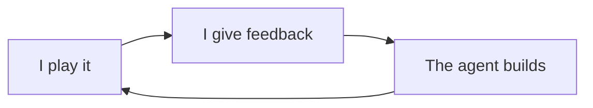

# Can you beat the Algorithm?

## Using GenAI to create an OR Games Factory

Jens-Peter Joost · JPJ Solutions

<div class="abs-bl m-6 text-sm opacity-70">
  GOR AG Praxis der Mathematischen Optimierung · Munich · 26 November 2026
</div>

<!--
DRAFT 2, to Peter's agenda of 15 Nov. TODO marks what still needs your input.

Timing (35 min + 10 min discussion):
 0– 4  Ice breaker: play Norias of the Dunes
 4– 7  What was that? Why games?
 7–15  Building the arcade
15–20  Live tour of the games
20–30  So what?
30–35  Take-aways

Everything runs from the laptop, no venue wifi needed:
- the games: in the games repo, `npm run build:pages`, then serve `_site`
- the old version with all 32 games: see the notes on "The factory run"
-->

---
layout: image-right
image: /assets/games/norias-of-the-dunes.jpg
backgroundSize: contain
---

# Let's play

Norias of the Dunes

<v-clicks>

- A desert, thirsty palms, a handful of water wheels.
- Each wheel waters the palms within its reach.
- Water as many palms as you can.

</v-clicks>

<v-click>

**You tell me where the wheels go.**

</v-click>

<!--
LIVE. Switch to the browser: Norias of the Dunes, first oasis, already past the title and the how-to.
Play ONE level with the room, then skip straight to the optimizer: your wheels next to the proven optimum.

If the demo fails: the Norias clips are on the backup slides at the end.
-->

---

# What was that?

<v-clicks>

- A **game**: a setting, a few wheels, a score.
- A **facility-location problem**: where do you put a limited number of sites to serve the most demand?
- And an **algorithm** that solved the same level, live, and proved the best answer.

</v-clicks>

<!--
Bridge from the game into the talk. Keep it short.
The solver behind this game is a MILP (maximal covering location) solved by HiGHS in the browser.
-->

---
layout: image-right
image: /assets/peter.png
---

# Hello there!

I'm Peter.

```
2018             M.Sc. Mathematics
2019 - 2025      Data Scientist at DHL
Since 04/2025    OR Freelancer, JPJ Solutions
```

---
layout: image-right
image: /assets/apple-game.jpg
backgroundSize: contain
---

# Games as a way in

What I have believed for years

<v-clicks>

- Games are a great entry point for stakeholders to **understand OR**.
- You do not explain the problem. People **feel** it.
- Then you show what an algorithm does with it.

</v-clicks>

<!--
The picture: my apple-collection game (a capacitated vehicle routing problem): jpjj.github.io/cvrp_game

ANECDOTE (no slide): the fair at DHL. People had to solve a small CVRP instance by hand.
It really made them understand what our division does.
-->

---

# Then came agentic coding

<v-clicks>

- With GenAI and coding agents, I felt free to **try more**.
- First the apple game, and a few others.
- Then the idea got bigger: **an arcade**.

</v-clicks>

---
layout: section
---

# Building the arcade

---
layout: image-right
image: /assets/dh-2d.jpg
backgroundSize: contain
---

# One flagship first

Dungeon Hoard

<v-clicks>

- The idea: the inventory from Diablo II.
- Load all the valuable stuff into a pack that is too small.
- Go back to the merchant and sell.
- Underneath: a 2D knapsack problem, solved live.

</v-clicks>

<!--
The picture is the very first version: one HTML file.
Optional LIVE: open `dungeon-hoard.html` from the root of the games repo — it still runs.
-->

---

# Refine, in a loop



<v-clicks>

- From one static HTML file to a real project: tests, a real solver in the browser.
- Round after round, until it looked good.
- Then I wrote the way of working down as a **recipe**.

</v-clicks>

<!--
The recipe lives in one file in the repo that the agent reads first: what the project is for,
how a game is built, and what "done" means (build, tests, a play-through in a headless browser).
-->

---

# The factory run

<v-clicks>

- Scheduled agent runs, nobody at the keyboard.
- The instruction: **come up with a new game idea and follow the recipe.**
- Every fifth run: brainstorm new ideas and tidy the repo.
- **25 new games in four days** (22–25 June 2026).

</v-clicks>

<!--
Each run was a fresh session: pick an idea, build the solver with tests, build the game,
play it through in a headless browser, merge if everything is green.
Source: AUTORUN_LOG.md on the `experiment` branch of the games repo.

LIVE: browse the old version with all 32 games. On the laptop, once:
  cd games
  git fetch origin experiment
  git worktree add ../games-experiment origin/experiment
  cd ../games-experiment
  npm ci
  OVERVIEW_GAMES="*" npm run build:pages
then serve the folder `_site` (for example `npx serve _site`) and open it.
This was built and checked on 15 Nov: all 32 pages open.
-->

---
layout: image
image: /assets/all-games.jpg
backgroundSize: contain
---

<!--
All 32 title cards of the old version: my 7 plus the 25 from the automatic runs.
Bin packing, scheduling, graph colouring, min-cost flow, set cover, spanning trees, and more.
-->

---
layout: fact
---

# 32 → 7

Many of the automatic ideas lacked creativity. Seven stayed: six were my ideas, one was the AI's.

<!--
The solvers were fine. The games were often the same game in a new costume.
(The AI's surviving idea was the maze game. No need to say which, unless asked.)
-->

---

# Last week: the next level

<v-clicks>

- A new model came out. I wanted to see how far the look could go.
- Every game rebuilt in **3D**. Same levels, same solvers, same proven optima.
- And an **island** to walk across, with one place per game.
- 40 commits in three days.

</v-clicks>

<!--
Tools: Claude Code throughout. The 2D versions mostly with Claude Opus 4.8, the 3D overhaul with Claude Fable 5.2.
An anecdote, not a benchmark.
-->

---
layout: two-cols
layoutClass: gap-8
---

# Before

June: flat pages


::right::

# After

November: a world


---
layout: image
image: /assets/games/hub.jpg
backgroundSize: contain
---

<!--
The island: walk to a place, press Play.
-->

---

# Let me show you

| Game                  | The problem inside                         | Where it costs real money        |
| --------------------- | ------------------------------------------ | -------------------------------- |
| Dungeon Hoard         | 2D knapsack / packing                      | Truck and container loading      |
| Norias of the Dunes   | Maximal covering location                  | Where to put sites and stations  |
| The Spice Route       | Travelling salesman                        | Routing and sequencing           |
| The Quest Board       | Assignment                                 | Who does which job               |
| Plunder Deck          | 3D loading with stacking rules             | Pallets and containers           |
| Cart & Run            | Prize-collecting capacitated routing       | Delivery with capacity and time  |
| The Labyrinth Keeper  | Shortest-path interdiction                 | Network resilience               |

<!--
LIVE, about 5 minutes: walk the island, open two or three games, show a reveal.
In every game a real solver runs live in the browser, and "optimal" is only said when it is proven.

Backup if the demo fails: "how to play" clips of every game on the last slides.
-->

---
layout: section
---

# So what?

---

# Coding. Modelling. Solving.

LLMs do remarkable things

<v-clicks>

- We have all seen what they do for **coding**.
- For modelling and solving, the results are getting remarkable too.
- One example: **203** open MIPLIB instances. **72** better solutions than the best known. **45** proved optimal.

</v-clicks>

<!--
Source: the vendor's own announcement (Anthropic, 9 Nov 2026); the solutions were submitted to MIPLIB.
TODO (Peter): check miplib.zib.de the week before and quote what is listed there. People who know MIPLIB closely are in the room.

Careful with the wording: this result is about SOLVING given instances. On modelling from a text description,
a 2026 benchmark built from MIPLIB (MIPLIB-NL, arXiv 2602.10450) reports a sharp drop on real-size models.
If someone asks: say so.
-->

---
layout: statement
---

# That was rarely my problem.

In my projects, model and solver performance were almost never what held us back.

---

# What did hold us back

<v-clicks>

- **Data quality**
- **Stakeholders and requirements**: what exactly is the problem, and what would a good solution look like?
- **Change management**: getting people to trust and use the result

</v-clicks>

---

# A common picture

<v-clicks>

- Developers, users and stakeholders have to mean **the same pain** and **the same solution**.
- Words and formulas rarely get them there.
- **Visualisation does.**

</v-clicks>

---
layout: statement
---

# And what are games, if not interactive visualisations?

---
layout: two-cols
layoutClass: gap-8
---

# The game

Where do the water wheels go?


::right::

# The project

Where do the warehouses go?


<!--
LIVE: back to Norias, to the last screen, and from there to the use case:
jpjsolutions.com/use-cases/facility-location (works offline from the laptop build of the website too).
The tool on the right is a neutral copy, on made-up data, of what I built for a client.
-->

---
layout: image-right
image: /assets/facility-rules.jpg
backgroundSize: contain
---

# A client project

Planners play facility location

<v-clicks>

- A visualisation, built with AI, of their own network question.
- They open and close sites and move customers.
- They can always compare with the **optimal solution**.
- And they can add **their own rules**, as they like.

</v-clicks>

<!--
TODO (Peter): one or two real things the planners changed, and why.
On the neutral copy every rule gets a price: e.g. "München stays open": +€441k a year.
-->

---

# What it gave us

<v-clicks>

- A fast exchange about **how the problem is defined**.
- The **requirements that were missing** came up by themselves.
- People without a technical background **understood and valued** what the solver can do.

</v-clicks>

---

# Take-aways

<v-clicks>

1. We all know it: **visualisation is key.**
2. OR can be visualised **very interactively**.
3. **Let your imagination run wild.**

</v-clicks>

---

# Let your imagination run wild

Reported in the newest model's first week

<v-clicks>

- A thousand agents formalised the proof of Fermat's Last Theorem in 30 hours.
- Three electronics prototypes, designed by the model, built and tested by engineers.
- Someone had it work out an undocumented USB keypad, and write six games for it.
- And an island with seven OR games.

</v-clicks>

<!--
TODO (Peter): pick your own favourites, and check each one against its original source before the talk.
I found these in launch-week write-ups (secondary sources), attributed to Anthropic's launch thread,
to Anthropic and Diode, and to a commentator's blog post:
- datacamp.com/blog/claude-fable-5-2-and-mythos-5-2
- oneusefulthing.org/p/fable-52-and-jagged-agi
- x.com/claudeai/status/2119867114450268322
-->

---
layout: two-cols
layoutClass: gap-8
---

# Can you beat the algorithm?

Try it

### games.jpjsolutions.com

<br>

The facility tool:

**jpjsolutions.com/use-cases/facility-location**

<br>

Jens-Peter Joost · jpjsolutions.com

::right::


<!--
10 minutes of discussion.
Questions to expect: what did it cost in hours and money; did you read the code; would you trust it on a client model;
client data and confidentiality; did the games bring any business; does this hold beyond toy instances.
-->

---
layout: two-cols
layoutClass: gap-8
zoom: 0.62
---

## Backup: Norias of the Dunes

<SlidevVideo controls>
  <source src="/assets/clips/norias-of-the-dunes-1.mp4" type="video/mp4" />
</SlidevVideo>

::right::

## &nbsp;

<SlidevVideo controls>
  <source src="/assets/clips/norias-of-the-dunes-2.mp4" type="video/mp4" />
</SlidevVideo>

<!--
Backup only. These are the games' own "how to play" clips, recorded from the real games.
-->

---
layout: two-cols
layoutClass: gap-8
zoom: 0.62
---

## Backup: Dungeon Hoard

<SlidevVideo controls>
  <source src="/assets/clips/dungeon-hoard-1.mp4" type="video/mp4" />
</SlidevVideo>

::right::

## &nbsp;

<SlidevVideo controls>
  <source src="/assets/clips/dungeon-hoard-2.mp4" type="video/mp4" />
</SlidevVideo>

---
layout: two-cols
layoutClass: gap-8
zoom: 0.62
---

## Backup: The Spice Route

<SlidevVideo controls>
  <source src="/assets/clips/spice-route-1.mp4" type="video/mp4" />
</SlidevVideo>

::right::

## &nbsp;

<SlidevVideo controls>
  <source src="/assets/clips/spice-route-2.mp4" type="video/mp4" />
</SlidevVideo>

---
layout: two-cols
layoutClass: gap-8
zoom: 0.62
---

## Backup: The Quest Board

<SlidevVideo controls>
  <source src="/assets/clips/quest-board-1.mp4" type="video/mp4" />
</SlidevVideo>

::right::

## &nbsp;

<SlidevVideo controls>
  <source src="/assets/clips/quest-board-2.mp4" type="video/mp4" />
</SlidevVideo>

---
layout: two-cols
layoutClass: gap-8
zoom: 0.62
---

## Backup: Plunder Deck

<SlidevVideo controls>
  <source src="/assets/clips/plunder-deck-1.mp4" type="video/mp4" />
</SlidevVideo>

::right::

## &nbsp;

<SlidevVideo controls>
  <source src="/assets/clips/plunder-deck-2.mp4" type="video/mp4" />
</SlidevVideo>

---
layout: two-cols
layoutClass: gap-8
zoom: 0.62
---

## Backup: Cart & Run

<SlidevVideo controls>
  <source src="/assets/clips/cart-and-run-1.mp4" type="video/mp4" />
</SlidevVideo>

::right::

## &nbsp;

<SlidevVideo controls>
  <source src="/assets/clips/cart-and-run-2.mp4" type="video/mp4" />
</SlidevVideo>

---
layout: two-cols
layoutClass: gap-8
zoom: 0.62
---

## Backup: The Labyrinth Keeper

<SlidevVideo controls>
  <source src="/assets/clips/labyrinth-keeper-1.mp4" type="video/mp4" />
</SlidevVideo>

::right::

## &nbsp;

<SlidevVideo controls>
  <source src="/assets/clips/labyrinth-keeper-2.mp4" type="video/mp4" />
</SlidevVideo>
