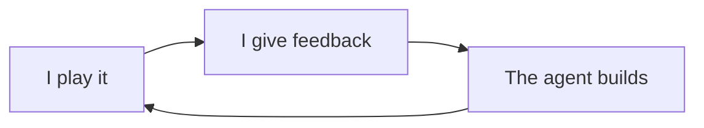

# Can you beat the Algorithm?

## Using GenAI to create an OR Games Factory

Jens-Peter Joost · JPJ Solutions

  GOR AG Praxis der Mathematischen Optimierung · Munich · 26 November 2026

<!--
DRAFT 3, to Peter's feedback of 16 Nov. TODO marks what still needs your input.

The whole deck runs on "next" alone: nothing has to be played or clicked live.
Every game moment is a silent video. A video either starts when its slide opens,
or it shows a still picture first and starts on the next "next" (noted on each slide).

Timing (35 min + 10 min discussion):
 0– 4  Ice breaker: the Norias of the Dunes play-through (2:48)
 4– 7  Why games?
 7–15  Building the arcade
15–20  The seven games, as clips
20–30  So what?
30–35  Take-aways

The pictures and game names are still links to the live sites, for a laptop with internet. They are not needed.
-->

---
layout: two-cols
layoutClass: gap-8
---

# Let's play

Norias of the Dunes

<v-clicks>

- A desert, thirsty palms, a handful of water wheels.
- Each wheel waters the palms within its reach.
- Water as many palms as you can.

</v-clicks>

::right::

 
 

<!--
Three clicks for the rules. The next slide is the play-through.
-->

---
layout: full
class: video-slide
---

<SlidevVideo autoplay autoreset="slide" muted controls poster="/assets/games/norias-of-the-dunes.jpg">
  <source src="/assets/videos/norias-of-the-dunes.mp4" type="video/mp4" />
</SlidevVideo>

<!--
VIDEO, starts by itself, no sound, 2:48: the full play-through of Norias of the Dunes, all five oases.
Talk over it. "Next" moves on at any time.

What to say while it runs: a game (a setting, a few wheels, a score); behind it a facility-location problem
(where do you put a limited number of sites to serve the most demand?); and an algorithm that solves
the same level live and proves the best answer. The solver is a MILP (maximal covering location), solved by HiGHS in the browser.
-->

---
layout: two-cols
layoutClass: gap-8
---

# Why games?

<v-clicks>

- Games are a fantastic way to **introduce people to OR**: students, end users, stakeholders.
- My first encounter: an internal fair at DHL. A colleague showed a very simple CVRP game. **His booth stole the show.**
- Last year I built that game myself.
- Players engage with the problem **on a deeper level** than by reading slides.

</v-clicks>

::right::

<SlidevVideo v-click="3" class="stay-visible" autoplay autoreset="slide" muted poster="/assets/apple-game.jpg">
  <source src="/assets/videos/apple-game.mp4" type="video/mp4" />
</SlidevVideo>

<!--
VIDEO: the picture is on the slide from the start. The clip starts with the third bullet ("Last year I built that game myself").
TODO (Peter): the clip is still missing. Save it as public/assets/videos/apple-game.mp4 (no sound). Until then the picture stays.

The game: my apple-collection game, a capacitated vehicle routing problem (jpjj.github.io/cvrp_game).
At the DHL fair people had to solve a small CVRP instance by hand. It really made them understand what our division does.
-->

---
class: genai-slide
---

# Enter agentic coding

<figure>
  <SlidevVideo autoplay autoreset="slide" muted loop>
    <source src="/assets/genai/1-pelican.mp4" type="video/mp4" />
  </SlidevVideo>
  <figcaption>Claude Opus 5.5 (Anthropic): a pelican on a bike, built in Three.js. Source: <a href="https://x.com/addyosmani/status/2102436416437580159">Addy Osmani on X, 22 Sep 2026</a></figcaption>
</figure>
<figure>
  <SlidevVideo autoplay autoreset="slide" muted loop>
    <source src="/assets/genai/2-penthouse.mp4" type="video/mp4" />
  </SlidevVideo>
  <figcaption>GPT-6 Astra (OpenAI): the demo house, from Blender to Unreal Engine 5. Source: <a href="https://x.com/Dimillian/status/2095596700815516004">Thomas Ricouard on X, 3 Sep 2026</a></figcaption>
</figure>
<figure>
  <SlidevVideo autoplay autoreset="slide" muted loop>
    <source src="/assets/genai/3-project-genie.mp4" type="video/mp4" />
  </SlidevVideo>
  <figcaption>Genie 3 (Google DeepMind): worlds you can walk through. Source: <a href="https://www.youtube.com/watch?v=YxkGdX4WIBE">Google DeepMind, "Project Genie", 29 Jan 2026</a></figcaption>
</figure>
<figure>
  <SlidevVideo autoplay autoreset="slide" muted loop>
    <source src="/assets/genai/4-gemini-omni-orbs.mp4" type="video/mp4" />
  </SlidevVideo>
  <figcaption>Gemini Omni (Google): generated video. Source: <a href="https://blog.google/innovation-and-ai/models-and-research/gemini-models/gemini-omni-3-5-videos">Google, The Keyword, 29 May 2026</a></figcaption>
</figure>

<!--
Four clips, all running at once, no sound, in a loop. The sources are under each clip.
1 Pelican: made with Claude Opus 5.5, but posted by Addy Osmani, not by Anthropic. Anthropic's own launch film has no pelican.
2 House: GPT-6 Astra. Posted by Thomas Ricouard, who built "the demo house for our launch blog post" at OpenAI. It is a house, not a penthouse.
3 and 4 are my picks, both from Google: generated worlds (Genie 3) and generated video (Gemini Omni). Neither was built by a coding agent.
With GenAI and coding agents I felt free to try more: first the apple game and a few others. Then the idea got bigger: an arcade.
-->

---
layout: image-right
image: /assets/original-games-arcade.jpg
---

# Building the arcade

<!--
The picture: the first arcade, the flat version from June.
-->

---
layout: two-cols
layoutClass: gap-8
---

# One flagship first

Dungeon Hoard

<v-clicks>

"Create a game where you are the hero slaying monsters. After a monster is slayn, you have to loot the items into your inventory. Your inventory is a 2d grid and every item has different shape and different value. The goal is to get as much value with you as possible since you cannot carry all (too many items for your inventory)."

</v-clicks>

::right::

<SlidevVideo v-click class="stay-visible" autoplay autoreset="slide" muted poster="/assets/videos/dungeon-hoard-original.jpg">
  <source src="/assets/videos/dungeon-hoard-original.mp4" type="video/mp4" />
</SlidevVideo>

<!--
First "next": the prompt. Second "next": the VIDEO starts (no sound, 1:18), me playing the very first version, one HTML file.
Before that the right side shows a still picture of it.
-->

---
layout: two-cols
layoutClass: gap-8
---

# Refine, in a loop

<v-clicks>

- From one static HTML file to a real project: tests, a real solver in the browser.
- Round after round, until it looked good.
- Then I wrote the way of working down as a **recipe**.

</v-clicks>

::right::

### The recipe

1. Pick an **OR problem** and dress it in a setting.
2. Build the game around a few small, handcrafted levels.
3. Build a **real solver**, with a test that proves the optimum.
4. Build the reveal: **you against the algorithm**, with the honest gap.
5. Explain the problem and where it shows up in business.
6. Done means: build green, tests green, a full play-through in a headless browser.

<!--
The recipe appears with the fourth "next", after the three bullets.
It lives in one file in the repo that the agent reads first: what the project is for,
how a game is built, and what "done" means. The slide is the short form; the file has ten steps.
One rule in it is not negotiable: say "optimal" only when the solver has proven it.
-->

---

# The factory run

<v-clicks>

- Scheduled agent runs, nobody at the keyboard.
- The instruction: **come up with a new game idea and follow the recipe.**
- Every fifth run: brainstorm new ideas and tidy the repo.
- **25 new games in four days** (22–25 June 2026).

</v-clicks>

<!--
Each run was a fresh session: pick an idea, build the solver with tests, build the game,
play it through in a headless browser, merge if everything is green.
Source: AUTORUN_LOG.md on the `experiment` branch of the games repo.
-->

---
layout: image
image: /assets/all-games.webp
backgroundSize: contain
---

<!--
All 32 title cards of the old version: my 7 plus the 25 from the automatic runs.
Bin packing, scheduling, graph colouring, min-cost flow, set cover, spanning trees, and more.
-->

---
layout: fact
---

# 32 → 7

Many of the automatic ideas lacked creativity. Seven stayed: six were my ideas, one was the AI's.

<!--
The solvers were fine. The games were often the same game in a new costume.
(The AI's surviving idea was the maze game. No need to say which, unless asked.)
-->

---

# With Fable 5.2 release: the next level

<v-clicks>

- A new model came out. I wanted to see how far the look could go.
- Every game rebuilt in **3D**. Same levels, same solvers, same proven optima.
- And an **island** to walk across, with one place per game.
- 40 commits in three days.

</v-clicks>

<!--
Tools: Claude Code throughout. The 2D versions mostly with Claude Opus 4.8, the 3D overhaul with Claude Fable 5.2.
An anecdote, not a benchmark.
-->

---
layout: two-cols
layoutClass: gap-8
---

# Before

June: flat pages

::right::

# After

November: a world

---
layout: full
class: video-slide
---

<SlidevVideo v-click class="stay-visible" autoplay autoreset="slide" muted poster="/assets/games/hub.jpg">
  <source src="/assets/videos/optimal-realm-into-dungeon-hoard.mp4" type="video/mp4" />
</SlidevVideo>

<!--
The slide opens on the picture of the island. "Next" starts the VIDEO (no sound, 1:21):
me walking across the Optimal Realm and into Dungeon Hoard. "Next" again moves on.
-->

---
layout: two-cols
layoutClass: gap-8
zoom: 0.62
---

## [Dungeon Hoard](https://games.jpjsolutions.com/dungeon-hoard/)

<SlidevVideo autoplay autoreset="slide" controls>
  <source src="/assets/clips/dungeon-hoard-1.mp4" type="video/mp4" />
</SlidevVideo>

::right::

## &nbsp;

<SlidevVideo v-click autoplay autoreset="slide" controls>
  <source src="/assets/clips/dungeon-hoard-2.mp4" type="video/mp4" />
</SlidevVideo>

<!--
LET ME SHOW YOU, about 5 minutes. Seven games, one slide each.
Arriving on a slide plays the first clip; "next" plays the second; "next" again goes to the next game.
In every game a real solver runs live in the browser, and "optimal" is only said when it is proven.

Dungeon Hoard: 2D knapsack / packing.
-->

---
layout: two-cols
layoutClass: gap-8
zoom: 0.62
---

## [Norias of the Dunes](https://games.jpjsolutions.com/norias-of-the-dunes/)

<SlidevVideo autoplay autoreset="slide" controls>
  <source src="/assets/clips/norias-of-the-dunes-1.mp4" type="video/mp4" />
</SlidevVideo>

::right::

## &nbsp;

<SlidevVideo v-click autoplay autoreset="slide" controls>
  <source src="/assets/clips/norias-of-the-dunes-2.mp4" type="video/mp4" />
</SlidevVideo>

<!--
Norias of the Dunes: maximal covering location.
-->

---
layout: two-cols
layoutClass: gap-8
zoom: 0.62
---

## [The Spice Route](https://games.jpjsolutions.com/spice-route/)

<SlidevVideo autoplay autoreset="slide" controls>
  <source src="/assets/clips/spice-route-1.mp4" type="video/mp4" />
</SlidevVideo>

::right::

## &nbsp;

<SlidevVideo v-click autoplay autoreset="slide" controls>
  <source src="/assets/clips/spice-route-2.mp4" type="video/mp4" />
</SlidevVideo>

<!--
The Spice Route: travelling salesman.
-->

---
layout: two-cols
layoutClass: gap-8
zoom: 0.62
---

## [The Quest Board](https://games.jpjsolutions.com/quest-board/)

<SlidevVideo autoplay autoreset="slide" controls>
  <source src="/assets/clips/quest-board-1.mp4" type="video/mp4" />
</SlidevVideo>

::right::

## &nbsp;

<SlidevVideo v-click autoplay autoreset="slide" controls>
  <source src="/assets/clips/quest-board-2.mp4" type="video/mp4" />
</SlidevVideo>

<!--
The Quest Board: assignment.
-->

---
layout: two-cols
layoutClass: gap-8
zoom: 0.62
---

## [Plunder Deck](https://games.jpjsolutions.com/plunder-deck/)

<SlidevVideo autoplay autoreset="slide" controls>
  <source src="/assets/clips/plunder-deck-1.mp4" type="video/mp4" />
</SlidevVideo>

::right::

## &nbsp;

<SlidevVideo v-click autoplay autoreset="slide" controls>
  <source src="/assets/clips/plunder-deck-2.mp4" type="video/mp4" />
</SlidevVideo>

<!--
Plunder Deck: 3D loading with stacking rules.
-->

---
layout: two-cols
layoutClass: gap-8
zoom: 0.62
---

## [Cart & Run](https://games.jpjsolutions.com/cart-and-run/)

<SlidevVideo autoplay autoreset="slide" controls>
  <source src="/assets/clips/cart-and-run-1.mp4" type="video/mp4" />
</SlidevVideo>

::right::

## &nbsp;

<SlidevVideo v-click autoplay autoreset="slide" controls>
  <source src="/assets/clips/cart-and-run-2.mp4" type="video/mp4" />
</SlidevVideo>

<!--
Cart & Run: prize-collecting capacitated routing.
-->

---
layout: two-cols
layoutClass: gap-8
zoom: 0.62
---

## [The Labyrinth Keeper](https://games.jpjsolutions.com/labyrinth-keeper/)

<SlidevVideo autoplay autoreset="slide" controls>
  <source src="/assets/clips/labyrinth-keeper-1.mp4" type="video/mp4" />
</SlidevVideo>

::right::

## &nbsp;

<SlidevVideo v-click autoplay autoreset="slide" controls>
  <source src="/assets/clips/labyrinth-keeper-2.mp4" type="video/mp4" />
</SlidevVideo>

<!--
The Labyrinth Keeper: shortest-path interdiction.
-->

---
layout: section
---

# So what?

---

# Coding. Modelling. Solving.

LLMs do remarkable things

<v-clicks>

- We have all seen what they do for **coding**.
- For modelling and solving, the results are getting remarkable too.
- One example: **203** open MIPLIB instances. **72** better solutions than the best known. **45** proved optimal.

</v-clicks>

<!--
Source: the vendor's own announcement (Anthropic, 9 Nov 2026); the solutions were submitted to MIPLIB.
TODO (Peter): check miplib.zib.de the week before and quote what is listed there. People who know MIPLIB closely are in the room.

Careful with the wording: this result is about SOLVING given instances. On modelling from a text description,
a 2026 benchmark built from MIPLIB (MIPLIB-NL, arXiv 2602.10450) reports a sharp drop on real-size models.
If someone asks: say so.
-->

---
layout: statement
---

# That was rarely my problem.

In my projects, model and solver performance were almost never what held us back.

---

# What did hold us back

<v-clicks>

- **Data quality**
- **Stakeholders and requirements**: what exactly is the problem, and what would a good solution look like?
- **Change management**: getting people to trust and use the result

</v-clicks>

---

# A common picture

<v-clicks>

- Developers, users and stakeholders have to mean **the same pain** and **the same solution**.
- Words and formulas rarely get them there.
- **Visualisation does.**

</v-clicks>

---
layout: statement
---

# And what are games, if not interactive visualisations?

---
layout: two-cols
layoutClass: gap-8
---

# The game

Where do the water wheels go?

::right::

# The project

Where do the warehouses go?

<!--
No live demo needed: the two pictures side by side make the point.
The tool on the right is a neutral copy, on made-up data, of what I built for a client.
-->

---
layout: two-cols
layoutClass: gap-8
---

# A client project

Planners play facility location

<v-clicks>

- A visualisation, built with AI, of their own network question.
- They open and close sites and move customers.
- They can always compare with the **optimal solution**.
- And they can add **their own rules**, as they like.

</v-clicks>

::right::

 
 

<!--
TODO (Peter): one or two real things the planners changed, and why.
On the neutral copy every rule gets a price: e.g. "München stays open": +€441k a year.
-->

---

# What it gave us

<v-clicks>

- A fast exchange about **how the problem is defined**.
- The **requirements that were missing** came up by themselves.
- People without a technical background **understood and valued** what the solver can do.

</v-clicks>

---

# Take-aways

<v-clicks>

1. We all know it: **visualisation is key.**
2. OR can be visualised **very interactively**.
3. **Let your imagination run wild.**

</v-clicks>

---
layout: two-cols
layoutClass: gap-8
---

# Can you beat the algorithm?

Try it

### games.jpjsolutions.com

 

The facility tool:

**jpjsolutions.com/use-cases/facility-location**

 

Jens-Peter Joost · jpjsolutions.com

::right::

<!--
10 minutes of discussion.
Questions to expect: what did it cost in hours and money; did you read the code; would you trust it on a client model;
client data and confidentiality; did the games bring any business; does this hold beyond toy instances.
-->
